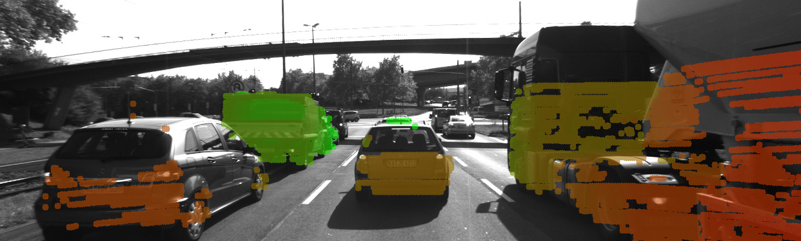
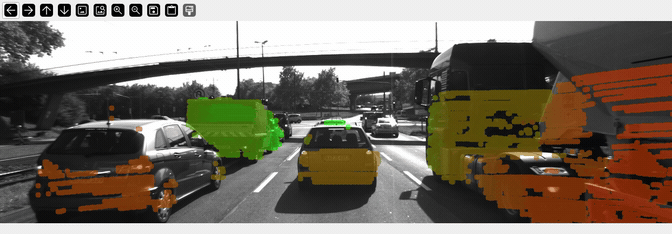

# 01. 센서 좌표계와 카메라 투영

LiDAR 점을 카메라 좌표계로 옮긴 뒤 영상에 투영한다. 영상의 물체 윤곽과 투영된 점의 위치를 비교합니다.



오른쪽 트럭과 앞차를 보면 LiDAR가 닿은 표면을 따라 색점이 모인다. 한 점의 위치는 LiDAR 좌표를 카메라 좌표로 변환한 뒤 깊이로 나눠 얻은 픽셀이다. 색은 차량 전방 거리 $x$를 나타낸다. 가까운 점은 붉고, 20m 부근의 점은 초록색이다.

아래 명령은 이 실습의 `build/`에서 실행합니다.

```bash
./3d_point_camera_projection ../data/image/0000000000.png ../data/dat/C51_LidarPts_0000.dat
```

## 실행 영상



영상 중앙의 앞차를 확대해 색점이 차체의 어느 부분에 맺히는지 확인한 뒤 전체 도로 장면과 비교한다. [MP4로 보기 · 7.6초](media/demo.mp4)
