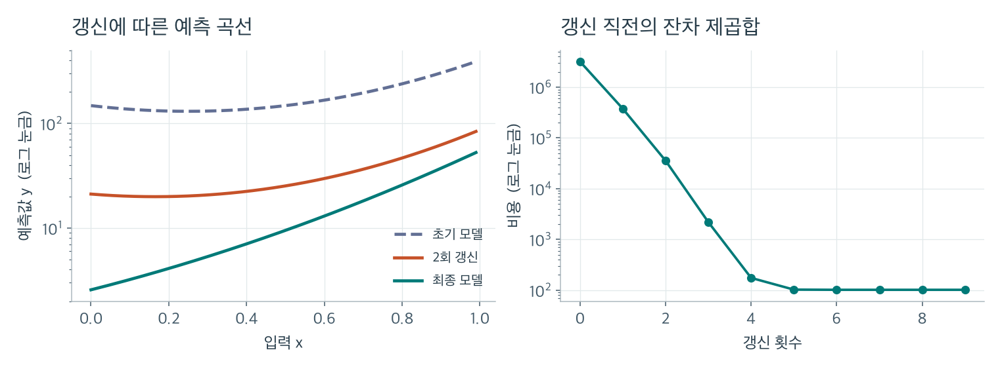

# 02. 비선형 최소제곱

같은 곡선 피팅 문제를 Gauss–Newton, Ceres, g2o로 푼다. 세 구현의 추정 계수와 반복 과정에서 비용이 줄어드는 양상을 비교합니다.



왼쪽은 같은 입력 $x$에서 모델 $y=\exp(ax^2+bx+c)$의 예측이 어떻게 바뀌는지 보여준다. 오른쪽은 `gauss_newton`이 출력한 100개 관측의 잔차 제곱합이다. 처음 몇 번의 갱신에서 약 320만이던 비용이 급격히 줄고, 마지막에는 약 102에서 거의 변하지 않는다. 두 그래프의 세로축은 로그 눈금이다.

아래 명령은 이 실습의 `build/`에서 실행합니다.

```bash
./gauss_newton
./g2o_curve_fitting
./ceres_curve_fitting
```
