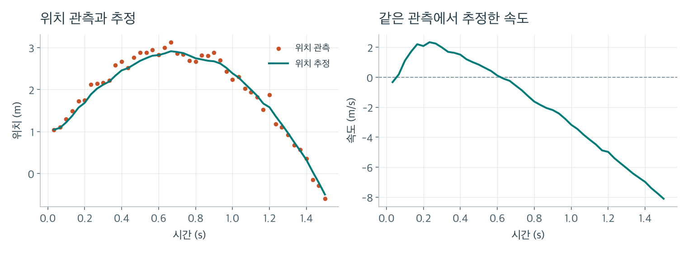

# 03. 칼만 필터

위치 관측값으로 위치·속도·가속도를 추정한다. 각 시각의 관측값과 갱신된 상태 추정값을 비교합니다.



왼쪽의 주황색 점은 1/30초마다 입력한 위치 관측이고, 청록색 선은 `kalman-test`가 갱신한 위치다. 약 0.7초에서 위치가 정점을 지날 때 오른쪽의 추정 속도도 양수에서 음수로 바뀐다. 속도 센서 없이 위치의 변화와 운동 모델만으로 얻은 값이다.

아래 명령은 이 실습의 `build/`에서 실행합니다.

```bash
./kalman-test
```
