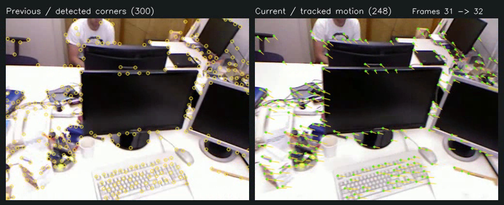
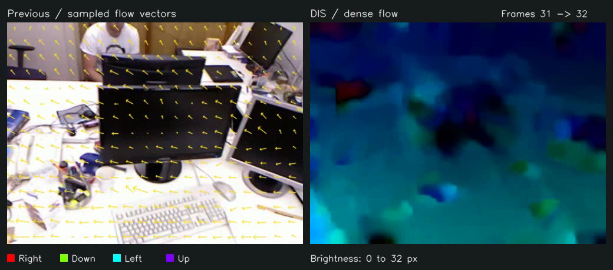

# 05. Optical flow — LK와 DIS

동영상의 연속 프레임에서 카메라나 물체의 움직임이 화면에 어떻게 나타나는지 비교한다. 두 예제 모두 오른쪽이 양의 x, 아래쪽이 양의 y이며 변위 단위는 픽셀이다.

아래 두 그림은 같은 영상의 **31번 → 32번 프레임**을 처리한 결과다. 모니터 테두리와 검은 화면 안쪽을 비교해 보자.



**LK**는 검출한 코너 300개 중 왕복 검사를 통과한 248개의 이동을 오른쪽에 표시한다. 테두리나 키보드처럼 밝기가 여러 방향으로 달라지는 곳에 추적점이 모인다.



**DIS**의 오른쪽에서는 코너 사이에도 색이 이어진다. 아래 범례와 색을 대조하면 이동 방향을 읽을 수 있고, 같은 방향에서는 밝을수록 변위가 크다.

| 예제 | 어디에서 변위를 구하는가? | 화면에서 확인할 것 |
|---|---|---|
| 피라미드 Lucas–Kanade (LK) | 첫 영상에서 검출한 코너 중 추적에 성공한 점 | 코너가 어디에 몰려 있는지, 어느 점이 다음 영상까지 추적되는지 |
| Dense Inverse Search (DIS) | 첫 영상의 모든 픽셀 | 물체 경계에서 이동 방향이나 크기가 어떻게 달라지는지 |

## 동영상으로 실행하기

저장소 루트에서 `./build.sh`로 빌드한 뒤 아래 명령을 실행한다. 각 명령은 창 하나에서 6초짜리 실내 촬영 영상을 끝까지 재생한다. 재생 중 `q`나 `Esc`를 누르면 일찍 종료할 수 있다.

```bash
cd lessons/02_visual_odometry/05_optical_flow
./run.sh lk --video
./run.sh dis --video
```

직접 촬영한 영상은 `--video` 뒤에 경로를 넣는다. 결과 영상을 저장하려면 `--output`을 붙인다. 아래 두 번째 명령은 샘플을 창 없이 처리해 현재 폴더의 `lk_result.mp4`에 저장한다.

```bash
./run.sh dis --video ~/Movies/walk.mp4
SLAM_HEADLESS=1 ./run.sh lk --video --output lk_result.mp4
```

화면 오른쪽 위의 프레임 번호를 보면서 카메라가 움직이는 방향과 화살표 방향을 비교해 본다. 각 화살표는 직전 프레임에서 현재 프레임까지의 변위다. LK는 매 프레임 쌍마다 코너를 새로 검출한다. 샘플은 초당 15프레임으로 총 90프레임이며, 결과 영상에는 89개 프레임 쌍이 한 장면씩 담긴다.

샘플은 J. Sturm, N. Engelhard, F. Endres, W. Burgard, D. Cremers의 TUM RGB-D SLAM Dataset 중 `freiburg1_xyz` RGB 영상에서 4초부터 6초간 발췌해 480×360, 15fps로 변환한 것이다. [원본 영상](https://cvg.cit.tum.de/rgbd/dataset/freiburg1/rgbd_dataset_freiburg1_xyz-rgb.avi) · [데이터셋](https://cvg.cit.tum.de/data/datasets/rgbd-dataset) · [CC BY 4.0](https://creativecommons.org/licenses/by/4.0/)

## LK — 코너 추적

[src/optical_flow.cpp](src/optical_flow.cpp)는 Shi–Tomasi 코너를 최대 300개 검출한 뒤 피라미드 LK로 추적한다. 두 번째 영상에서 첫 번째 영상으로 다시 추적해 원래 코너에서 1픽셀 이내로 돌아온 점을 남긴다. 왼쪽은 검출된 코너, 오른쪽은 이동 화살표와 도착점(초록색)이다.

## DIS — 픽셀별 이동장

[src/dis_optical_flow.cpp](src/dis_optical_flow.cpp)는 OpenCV의 DIS 중간 품질 프리셋으로 픽셀마다 수평·수직 변위를 추정한다. 왼쪽에는 24픽셀 간격으로 화살표를 표시하고 오른쪽에는 전체 이동장을 그린다. 색상은 아래 범례의 방향을, 밝기는 이동 크기를 나타낸다. 0픽셀은 검은색이고 32픽셀 이상은 최대 밝기다. 무늬가 적은 벽에도 값이 나오므로 주변의 뚜렷한 경계와 함께 해석한다. [OpenCV DIS 문서](https://docs.opencv.org/4.x/de/d4f/classcv_1_1DISOpticalFlow.html)

## 정지 이미지 두 장으로 비교하기

실습 폴더에서 `./run.sh lk` 또는 `./run.sh dis`를 실행하면 04번 실습과 같은 이미지 두 장을 비교한다. 이미지 창에서 키를 누르면 종료된다. 다른 이미지도 같은 크기의 두 장을 실행 파일에 전달하면 된다. 아래는 이 실습의 `build/`에서 창 없이 실행하는 예다.

```bash
SLAM_HEADLESS=1 ./optical_flow ../data/1.png ../data/2.png
SLAM_HEADLESS=1 ./dis_optical_flow ../data/1.png ../data/2.png
```

각각 `optical_flow.png`와 `dis_optical_flow.png`를 저장한다. 두 실행 파일 모두 터미널에 변위의 성분별 중앙값을 출력한다. LK는 왕복 검사를 통과한 코너에서, DIS는 전체 픽셀에서 계산하므로 두 값은 서로 다를 수 있다. OpenCV 3에서 DIS를 빌드할 때는 contrib의 `optflow` 모듈이 필요하다.
