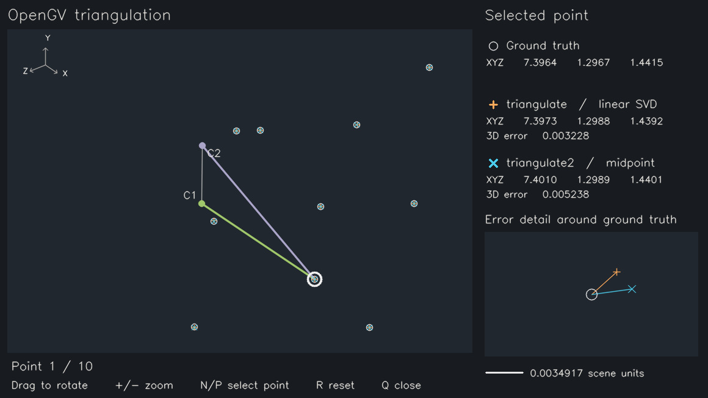

# 08. OpenGV 삼각측량

07번 실습에서 본 두 관측 광선으로 3D 점을 복원하되, 여기서는 정답을 아는 합성점 10개를 사용한다. 동일한 카메라 자세와 노이즈가 섞인 동일한 관측 방향을 OpenGV의 두 방법에 입력한다.

저장소 루트에서 다음 명령으로 강의 예시 장면을 연다. 같은 환경에서 `--seed 20`을 유지하면 같은 점과 카메라 배치를 재현할 수 있다. 인자 없이 실행하면 매번 새 장면을 생성한다.

```bash
./lessons/02_visual_odometry/08_opengv_triangulation/run.sh --seed 20
```



왼쪽의 C1과 C2는 카메라 중심이다. 두 중심에서 나오는 선은 선택한 점의 관측 광선이다. 오른쪽 위에는 첫 카메라 좌표계에서의 정답과 추정 좌표, 정답까지의 3D 유클리드 거리가 표시된다. 거리는 합성 장면의 좌표 단위다.

| 표시 | 의미 |
|---|---|
| 흰 원 | 장면 생성에 사용한 정답 3D 점 |
| 주황색 `+` | `triangulate`가 선형 방정식을 특이값 분해(SVD)로 풀어 복원한 점 |
| 청록색 `×` | `triangulate2`가 두 관측 직선에서 서로 가장 가까운 두 위치의 중점으로 복원한 점 |

왼쪽에서 드래그해 시점을 돌리면 두 광선 사이의 각도를 볼 수 있다. `n` / `p`로 다음 / 이전 점을 고른다. 전체 장면에서 두 추정값이 겹쳐 보일 때는 오른쪽 아래 확대 그림에서 흰 원과 두 기호 사이의 간격을 확인한다. 확대 그림도 함께 회전하며, 아래 눈금은 선택한 점에 맞춘 거리 척도다. `+` / `-`로 전체 장면을 확대·축소하고, `r`로 시점을 초기화하며, `q` 또는 `Esc`로 종료한다.

아래 명령은 기본 시점을 실습 폴더의 `build/opengv_triangulation.png`에 저장한다. 두 방법의 점별 오차와 실행 시간은 터미널에서도 확인할 수 있다.

```bash
SLAM_HEADLESS=1 ./lessons/02_visual_odometry/08_opengv_triangulation/run.sh --seed 20
```
