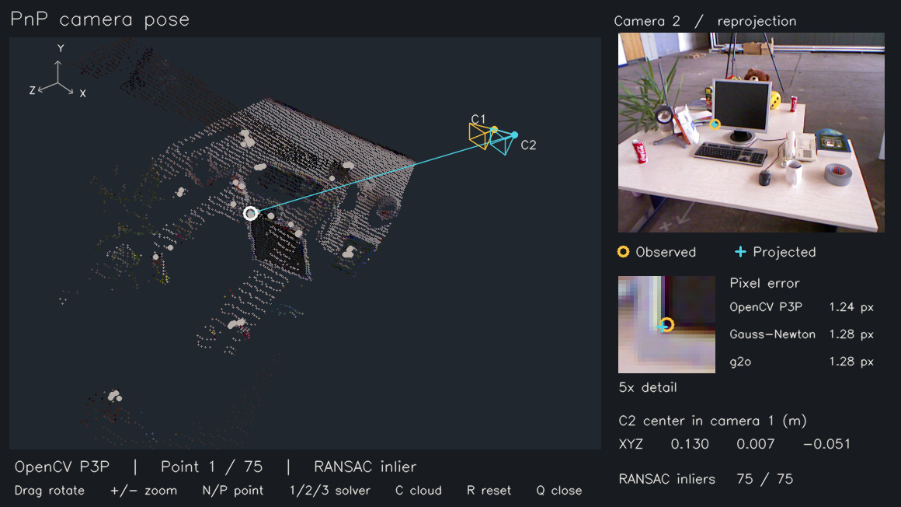

# 09. PnP와 카메라 자세

첫 번째 RGB-D 영상에서 위치를 아는 3D 점을 두 번째 사진에서도 찾으면 두 번째 카메라의 자세를 추정할 수 있다. 3D 장면에서 추정한 카메라를 돌려 보고, 그 자세로 예측한 픽셀이 실제 관측점에 얼마나 가까운지 확인한다.

저장소 루트에서 실행한다.

```bash
./lessons/02_visual_odometry/09_pnp/run.sh
```



왼쪽의 노란 피라미드 C1은 기준 카메라, 청록색 C2는 선택한 방법으로 추정한 두 번째 카메라다. 회색 점은 PnP에 전달한 3D 기준점이고 흰 원은 선택한 점이다. 주변의 색상 점군은 첫 번째 깊이 영상을 5픽셀 간격으로 읽어 만든 배경이다.

오른쪽 사진의 **노란 고리**는 ORB로 관측한 대응점이고, **청록색 십자**는 선택한 자세로 기준점을 재투영한 위치다. 두 표시의 중심 사이 거리를 원본 영상의 픽셀 단위로 표시한다. 작은 차이는 사진 아래의 5배 확대 그림에서 볼 수 있다.

| 조작 | 기능 |
|---|---|
| 왼쪽 드래그, `+` / `-` | 장면 회전, 확대 / 축소 |
| `1` / `2` / `3` | OpenCV P3P·RANSAC / Gauss–Newton / g2o의 자세 선택 |
| `n` 또는 스페이스 / `p` | 다음 / 이전 대응점 선택 |
| `c` | 배경 점군 숨기기 또는 다시 보기 |
| `r` / `q` 또는 `Esc` | 시점 초기화 / 종료 |

## 좌표와 오차 읽기

첫 번째 사진의 특징점에서 깊이값을 읽어 5000으로 나누면 미터 단위 깊이가 된다. 내부 파라미터 $K$로 역투영한 3D 기준점을 $X_1$이라 하면 각 방법이 추정하는 자세는 $X_2=RX_1+t$이다. 따라서 왼쪽에 그리는 두 번째 카메라의 중심은 첫 번째 카메라 좌표계에서 $-R^Tt$이며, 오른쪽 픽셀은 $KX_2$를 깊이로 나눠 구한다.

OpenCV는 RANSAC으로 대응점을 선별한다. Gauss–Newton과 g2o는 깊이가 유효한 전체 대응점으로 재투영 오차를 최적화한다. 화면의 inlier 표시는 OpenCV의 RANSAC 판정을 뜻하며, 오차 표는 **현재 선택한 한 점**에 대한 세 방법의 결과다.

창 없이 실행하면 기본 시점을 실습 폴더의 `build/pnp_pose.png`에 저장한다.

```bash
SLAM_HEADLESS=1 ./lessons/02_visual_odometry/09_pnp/run.sh
```
