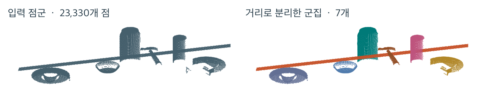

# 10. 포인트 클라우드 처리

점군을 필터링하고 법선을 추정한 뒤 군집을 분리한다. 필터 전후 점 개수, 법선 방향, 군집별로 저장되는 PCD 파일을 확인합니다.



왼쪽은 `clustering_data.pcd`의 점 23,330개다. 오른쪽은 `clustering`이 저장한 `cloud_cluster_0.pcd`부터 `cloud_cluster_6.pcd`까지를 군집마다 다른 색으로 겹쳐 그린 그림이다. 코드는 2cm 이내의 이웃을 따라 점들을 연결한다. 가운데 기둥과 그 뒤의 긴 막대가 화면에서는 겹쳐 보여도 3D에서 떨어져 있어 다른 군집에 속한다.

아래 명령은 이 실습의 `build/`에서 실행합니다.

```bash
./voxel_grid_filter ../data/vgf_data.pcd
./statistical_outlier_filter ../data/sof_data.pcd
./pass_through_filter ../data/ptf_data.pcd
./normal_estimation ../data/ne_data.pcd
./clustering ../data/clustering_data.pcd
```
