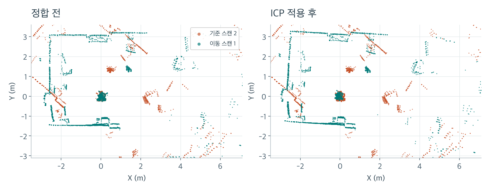
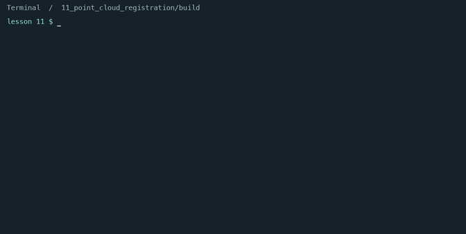

# 11. 점군 정합

대응점 기반 SVD 정합과 반복 최근접점 정합(ICP)을 실험한다. RGB-D 영상에서 구한 강체 변환과 방 스캔 두 장의 ICP 수렴 여부를 각각 확인합니다.



주황색은 고정한 `room_scan2`, 청록색은 움직이는 `room_scan1`이다. 오른쪽은 실행 파일이 출력한 4×4 변환 행렬을 첫 번째 스캔에 적용한 결과다. 두 그림 모두 $|z|<0.35$ m인 점을 위에서 본다. 왼쪽 벽의 방향은 조금 바뀌지만 겹치지 않는 윤곽도 남는다. 터미널의 `has converged:1`은 ICP가 종료 조건에 도달했다는 뜻이므로 실제 정합 상태도 함께 확인한다.

아래 명령은 이 실습의 `build/`에서 실행합니다.

```bash
./closed_form_registration ../data/1.png ../data/2.png ../data/1_depth.png ../data/2_depth.png
./iterative_form_registration ../data/room_scan1.pcd ../data/room_scan2.pcd
```

## 실행 영상



먼저 RGB-D 대응점으로 구한 회전과 이동을 출력한 뒤, 두 방 스캔에 ICP를 실행한다. 마지막 4×4 행렬은 첫 스캔을 두 번째 스캔 좌표계로 옮기는 변환이다. [MP4로 보기 · 9.8초](media/demo.mp4)
