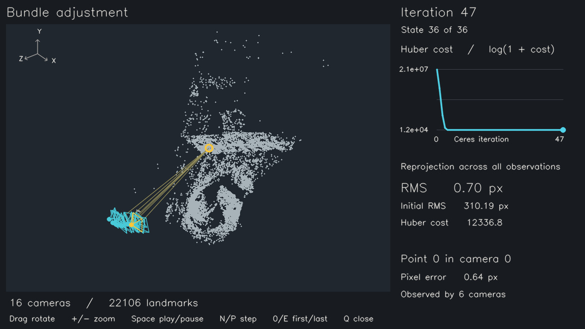
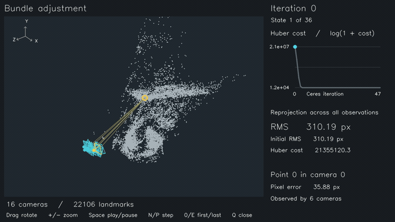

# 12. 번들 조정

하나의 3D 점을 여러 카메라가 관측한다. 번들 조정은 그 점을 각 영상에 다시 투영한 위치가 관측 픽셀에 가까워지도록 카메라와 3D 점을 함께 갱신한다. 이 실습은 BAL 데이터의 초기 추정값을 정규화하고 교란한 뒤, Ceres가 실제로 채택한 단계를 기록해 재생한다.

저장소 루트에서 실행한다.

```bash
./lessons/04_slam_backend/12_bundle_adjustment/run.sh
```



그림은 재생의 마지막 상태다. 오른쪽에서 전체 관측의 RMS 재투영 오차가 초기 310.19픽셀에서 0.70픽셀로 줄었음을 볼 수 있다. 아래의 `Pixel error`는 지금 선택한 점 하나의 오차다.

계산이 끝나면 첫 단계가 열린다. **스페이스**를 눌러 재생한다. 왼쪽의 피라미드는 카메라의 위치와 방향, 회색 점은 복원한 장면이다. 노란 고리는 첫 관측의 3D 점이고, 선은 그 점을 관측한 카메라 중심을 연결한다. 노란 카메라 하나의 투영 오차는 오른쪽 아래에서 읽을 수 있다.

| 조작 | 기능 |
|---|---|
| 스페이스 | 0.5초마다 한 단계 재생 / 일시정지. 마지막 상태에서는 처음부터 다시 재생 |
| `n` / `p` | 다음 / 이전 상태로 한 단계 이동 |
| `0` / `e` | 초기 / 최종 상태로 이동 |
| 왼쪽 드래그, `+` / `-` | 월드 +Y축을 위로 유지하며 회전, 확대 / 축소 |
| `r` / `q` 또는 `Esc` | 시점 초기화 / 종료 |

## 단계별로 확인할 값

- **Iteration**은 Ceres 반복 번호다. 초기 상태와 채택한 갱신만 재생하므로 거절한 단계의 번호는 건너뛴다.
- **Huber cost**는 이상치의 영향을 줄이는 Huber 손실을 적용한 Ceres 목적함수다. 그래프는 세로축에 `log(1 + cost)`를 적용하고 눈금에는 원래 비용을 표시한다.
- **RMS**는 모든 2D 관측에서 계산한 픽셀 거리 제곱의 평균에 제곱근을 취한 값이다. **Pixel error**는 강조한 카메라와 점 하나에서 측정한 픽셀 거리다.
- 카메라 기호는 BAL의 음의 Z축을 바라본다. 3D 그림에는 매 단계 동일한 점 ID를 최대 12,000개까지 표시하며, 최적화와 오차 계산에는 데이터 전체를 사용한다.

기본 샘플은 카메라 16대, 3D 점 22,106개, 2D 관측 83,718개다. 첫 몇 단계에서 오차가 얼마나 줄어드는지 먼저 보고, 마지막 단계와 비교해 본다.

## 영상으로 저장하기

```bash
SLAM_HEADLESS=1 ./lessons/04_slam_backend/12_bundle_adjustment/run.sh
```

실습 폴더의 `build/`에 재생 영상 `ba_iterations.mp4`와 마지막 화면 `ba_final.png`가 저장된다. 초기·최종 전체 점군은 각각 `initial.ply`와 `final.ply`에 저장된다.

## 실행 영상



초기 상태에서 재생을 시작한다. 카메라와 점군이 함께 움직일 때 오른쪽 그래프의 비용과 재투영 RMS가 어떻게 줄어드는지 보고, 마지막에 최종 상태로 이동한다. [MP4로 보기 · 7.6초](media/demo.mp4)
